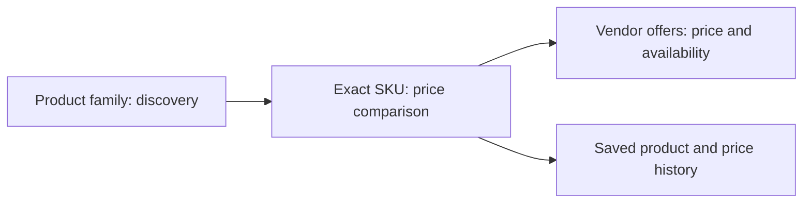

# App evaluation — November 1, 2026

This is the pre-implementation baseline. The implementation, verification and
remaining external-source limitations are recorded in [IMPLEMENTATION.md](IMPLEMENTATION.md).
Post-change replays are [local](evaluation-after.json) and
[production PostgreSQL 15](evaluation-production.json).

The highest priority is making price comparisons refer to the same product.
Search is fast enough to improve within PostgreSQL. Current identity rules,
query interpretation, filtering and watch keys can turn valid source prices
into misleading comparisons.

This is an evaluation and implementation proposal. No search, grouping or
frontend behavior was changed or deployed during this evaluation.

## Scope and evidence

- Refreshed catalog: **225,617 vendor offers**, 74 vendors with priced products.
  These are source offers, not 225,617 distinct real-world products.
- Ran 31 local queries through the actual retrieval and grouping functions,
  19 live search/browse requests, six live autocomplete probes, production query
  plans and eight search-to-price-watch consistency checks.
- Reviewed frontend search, filters, comparisons, saved products, locations,
  analytics, metadata and deployment configuration.
- Go tests, Go vet and frontend TypeScript checks passed. Direct ESLint reports
  **8 errors and 2 warnings**. `bun run lint` fails because the installed Next 16
  CLI does not provide `next lint`; the script needs to invoke ESLint directly.
- Browser automation reported no enabled browser. Visual layout, keyboard and
  screen-reader behavior, authenticated account flows, mobile apps and actual
  email delivery were not exercised. UI findings below are source-based.
- Query examples are synthetic tests. They are not production traffic or an
  estimate of user conversion. Sampled query plans are not a load test or p95.

Detailed, read-only scripts and raw results are in `cache/app-evaluation/`.
The durable compact baseline is [evaluation-baseline.json](evaluation-baseline.json).

## 1. Correct product identity before presenting savings — P0, larger change

### Observed behavior

| Case | Actual result | Why it matters |
|---|---|---|
| `magnezijum` | Top group has 484 raw offers, reduced to 63 vendor offers. It includes a 20 RSD “Magnezijum 300 Direkt”, capsules, a magnesium protein bar, liquid and sulfate powder. | Different products become one price comparison. Positive-price validation cannot catch this. |
| `vitamin d3 2000` | The leading group includes quantities 30, 50, 60, 96 and 100, plus unknown packs and several brands. | The lowest package price does not establish the best price for the same SKU. |
| `pampers premium care 4` | The leading group includes sizes 0, 1, 2 and 4; the cheapest visible listing is a single size-1 diaper at 29 RSD. | Size and pack constraints disappear, producing an especially misleading minimum. |
| Global base-key inspection | 84 multi-brand `brand-line`/`brand-sku` candidate groups. One combines Hipp, Humana and Novalac infant formula; another combines Pampers, Bambo and Violeta diapers. | The code's intended separation of baby products is not working for these examples. |

The 84 groups are **review candidates**, not an error-rate estimate: some brand
strings are legitimate aliases. The examples above were inspected separately.
The global dump contains 121,171 base groups, including 95,654 single-offer groups
and 19,266 groups spanning multiple vendors. It uses `BuildGroupKey` before the
query-dependent folding passes, so these totals are not search-result totals.

### Causes

- Ingredient groups intentionally ignore brand and pack. Existing tests explicitly
  require this behavior; passing tests therefore do not establish SKU equivalence.
- `Quantity` is supplied to the grouping engine but is not included in its keys.
- Unknown-form offers are assigned to the dominant form in the current result set.
- Gram weights are rounded into 50 g / 250 g buckets, including products other
  than protein tubs. An 800 g formula can be keyed as 750 g.
- Per-vendor deduplication then keeps only the cheapest offer in the broad group,
  hiding meaningful variants. “List” mode receives this already deduplicated data;
  turning grouping off does not restore every source offer.
- The toolbar promises the same product by dose **and pack**, which the model
  currently does not enforce.

Sources: [group keys](internal/matching/matching.go#L305),
[weight bucketing](internal/matching/matching.go#L222),
[vendor deduplication](main.go#L738), [form folding](main.go#L826),
[toolbar wording](frontend/components/ResultsToolbar.tsx).

### Proposed model

Separate three levels:

- **Family:** ingredient or related product line; suitable for browsing alternatives.
- **SKU:** manufacturer/brand, line, formulation, strength, form/route, exact pack
  or volume, plus relevant size, stage, shade or flavor. Preserve unknown fields
  and matching confidence rather than assigning them a known sibling's value.
- **Offer:** stable source product/variant ID, vendor/seller, SKU, price,
  availability, scrape run and observation timestamp.

Use source GTIN/EAN or manufacturer IDs when available, then conservative rules
and reviewed aliases. Keep uncertain matches separate. Apply unit conversions
exactly; use documented source corrections rather than broad weight rounding.
Add unit prices only where the unit and pack are reliable.

Immediately restrict “same product” and savings claims to confidently equivalent
offers. Display broader groups as alternatives with their differences visible.
Run the replacement grouper alongside the existing one and review split/merge
diffs before migrating watches or history.

## 2. Preserve query intent and improve autocomplete — P1, medium change

Live `ferveks` ranks **Salvit Fervit** first and also returns a Kurkuma group.
For `magnezijum citrat` and `magnezijum bisglicinat`, the local query interpreter
reduces both to the single required token `magnezijum`; they retrieve the same
2,024 offers. The salt/formulation qualifier no longer constrains retrieval.
For the Pampers size-4 query, the required tokens are `care`, `diapers`, `premium`:
the numeric size has been lost.

Autocomplete is also noisy: `mag` starts with “MAP”, while `ferveks` starts with
“Ferona”. Its predicate and distance ordering use opposite argument directions
for asymmetric word similarity. Moreover, final group ranking has no fuzzy match
score: typo candidates can receive a zero text score and then rank by vendor
coverage. It scores only the first three, price-sorted offers in a group, so a
more relevant but more expensive member may not influence the score.

Implement a shared, versioned query representation: lexical terms, brand, line,
ingredient, formulation, strength, pack and category-specific variant fields.
Preserve explicit constraints through retrieval, grouping and sorting. Normalize
Serbian Latin/Cyrillic and known aliases consistently in ingestion and queries.

Rank exact identifiers and brand/line matches first, then complete token matches,
then controlled synonyms. Offer an explicit spelling correction when needed.
Use fuzzy similarity as a ranking feature rather than discarding it after
candidate retrieval. Never silently relax a requested strength, size or formulation.
Autocomplete should prioritize useful prefixes and common matching SKUs/families,
deduplicate them and support keyboard selection and combobox semantics.

Important counterexample: `solgar vitamin d3 2000` returns zero, but the current
catalog also has no Solgar D3 title containing 2000. This was **not** classified
as a search defect. Distinguish missing inventory from failed recall.

Sources: [query concepts](internal/matching/matching.go#L645),
[retrieval](main.go#L128), [group scoring](main.go#L654),
[autocomplete](main.go#L274), [search input](frontend/components/SearchBar.tsx).

## 3. Make filters and pagination apply to the full intended result — P1

Selecting Solgar for `magnezijum` returns a leading 39-vendor group with **33
non-Solgar offers**, and a 180 RSD minimum from another brand. Filters retain a
whole group if one already deduplicated member matches. Deduplication can also
remove a matching brand before the filter runs.

Only brand and category trigger server filtering. Vendor, price, form, quantity
and dosage-unit filters apply to loaded pages. Users can see an empty or partial
result even though later pages contain matches. Price-range bounds also derive
from loaded offers. Dose filtering distinguishes units, not specific strengths.

The unary `SearchGroups` method ignores offset: offsets 0 and 2 return the same
two groups in a local replay. Negative limit panics locally. Streaming pagination
accepts negative offsets without validation. These malformed cases were not sent
to production. The normal website uses streaming, so the unary defect is not the
cause of its current infinite-scroll behavior.

Apply all filters before paging, with explicit SKU-versus-offer semantics.
Aggregate eligible offers after selecting matching SKUs. Calculate facets and
totals at a documented grain. Add deterministic ordering/cursors, request bounds,
query deadlines and cancellation. Guard initial search and autocomplete responses
against stale requests; the load-more path already has such a guard.

The 5,000-offer retrieval cap also makes broad-query totals and vendor coverage
potentially partial. Browse selects 5,000 offers from categories containing tens
of thousands. Retrieve SKU candidates and then aggregate their complete eligible
offers, or explicitly disclose the cap rather than reporting a complete total.

Sources: [group filtering](main.go#L501), [cached search](main.go#L1190),
[RPC paging](main.go#L1095), [client filters](frontend/app/page.tsx#L330).

## 4. Unify saved products and stabilize price history — P1

- The product-card heart uses the account-backed watchlist. The detail-modal heart
  uses a separate local-storage wishlist with its own `isLoggedIn` flag. The two
  controls therefore do not operate on one saved-product state.
- In list mode, the card sends the offer UUID as `groupKey`; the price-watch job
  indexes computed group keys. That watch cannot resolve as a product group.
- Group membership depends on the searched subset. One of seven groups returned
  for `vitamin d3 solgar` has no key in the full-catalog snapshot. Six of seven
  `cink solgar` groups have a different snapshot minimum: the tablet group's
  displayed minimum is **1,600 RSD**, versus **89 RSD** in the global snapshot.
- History is written only for watched groups. It is not a catalog-wide history,
  and the earlier production check showed no stored history points.

Use one authenticated watch API and stable SKU IDs across cards, detail pages,
history and alerts. Record offer price/availability observations during ingestion;
derive SKU history from equivalent offers and explicit eligibility rules. Version
identity mappings and migrate references deliberately when matching rules change.

Sources: [card heart](frontend/components/ProductCard.tsx#L79),
[modal heart](frontend/components/ProductDetailModal.tsx#L61),
[legacy wishlist](frontend/contexts/WishlistContext.tsx),
[snapshot computation](pricewatch.go#L44).

## 5. Catalog quality and operational trust — P1/P2

| Field / condition | Offers | Share of catalog |
|---|---:|---:|
| Scraped today, Belgrade calendar day | 223,538 | 99.08% |
| Search tokens populated | 225,531 | 99.96% |
| Core identity populated | 216,311 | 95.88% |
| Brand populated | 167,091 | 74.06% |
| Form populated | 84,579 | 37.49% |
| Pack quantity populated | 50,096 | 22.20% |
| Category populated | 171,960 | 76.22% |
| Older than 30 days | 2,079 | 0.92% |

Missingness is not automatically an error: quantities/forms have different
meanings for devices, cosmetics and supplements. Within Supplements & Vitamins,
12,766 of 49,870 offers lack a form and 18,455 lack a quantity. Unknown metadata
must not be turned into asserted SKU equivalence.

The stale offers belong to Apoteka Net (1,817), Apotekar Online (193), and Azgard
(69), all last observed September 8. Preserve their raw observations but exclude
them from current best-price/savings claims after a chosen freshness threshold,
or display them explicitly as stale. Other unavailable sources currently have no
offers in this catalog. The outage list and stale-offer population are different.

Normalize brand aliases such as `Biotech` / `Biotechusa` / `Biotech Usa`,
`7 Nutrition` / `7Nutrition` and `Josif Pancic` / `Jp` / `Ijp` with reviewed entity
IDs. Keep original titles and extraction provenance. Prioritize fields by category;
barcode, pack, variant and confidence coverage are more useful here than universal
LLM-generated canonical names.

Persist per-source scrape status, counts, coverage changes, last complete success
and enrichment version. A watchdog based on the newest file anywhere can hide one
vendor's prolonged outage. Schedule and monitor the full import/enrichment/sync
pipeline on the intended scraper host; a successful CSV alone is insufficient.

## 6. Performance and indexing — retain PostgreSQL; tune measured problems

Production `EXPLAIN ANALYZE` samples on the refreshed data:

| Query path | Execution time | Main work |
|---|---:|---|
| Precise `magnezijum` | 70.7 ms | Indexed candidates, sort 2,026 offers |
| Precise `protein` | 93.3 ms | Indexed candidates, sort 3,002 offers |
| Fuzzy `ferveks` | 32.0 ms | Indexed candidates, sort 30 offers |
| Autocomplete `vit` | 305.8 ms | Scan about 17,280 candidate offers and sort for 48 rows |

The Product lookups use the token/trigram indexes; a sequential scan of the
80-row Vendor table in these plans is not a catalog-scan problem. Local retrieval
across the 31 queries took 1.5–48.5 ms, with grouping up to 75.1 ms. These are
single-run measurements on different hardware from production.

Production cached requests measured from the server itself were approximately
2–35 ms. A reused external HTTPS connection usually took 174–190 ms, with some
slower samples. Fresh-connection timings were higher and include TLS/network
cost. None establishes a concurrent-load p95 or browser interaction latency.

Prioritize prefix autocomplete, smaller summary payloads with offer expansion on
demand, complete SKU-level pagination, cancellation/deadlines, and cache-miss
coalescing if a concurrency test shows duplicate work. The ten-group magnesium
JSON response is about 216 KB uncompressed. The current “stream” waits for the
entire retrieval/grouping operation and sends one complete page.

GIN trigram indexes can filter candidates; they do not provide GiST nearest-neighbor
distance ordering. Test a correctly oriented prefix/KNN design before adding an
index. The current data does not justify introducing another search service.
[PostgreSQL's index documentation](https://www.postgresql.org/docs/current/pgtrgm.html#PGTRGM-INDEX).

The local database is PostgreSQL 18.6 and production is 15.15. Main search and
matching source files match after CRLF normalization, but the session word-
similarity threshold is 0.6 locally versus 0.5 in production. Pin and explicitly
test search settings, dictionary versions and application build metadata so a
local relevance check reproduces production.

## 7. Other app improvements — P1/P2/P3

| Priority | Finding | Concrete improvement |
|---|---|---|
| P1 | `trackSearch(term, 0)` runs before search completes; no later correction was found. | Emit search completion with request ID, actual result count, latency and applied filters; connect clicks to query/rank. Measure real zero-result searches before judging relevance. |
| P1 | Analytics initializes immediately and writes consent as accepted; the consent argument is ignored. | Respect the user's actual analytics choice and minimize third-party collection of health-related search terms. This is a technical behavior finding, not a legal assessment. |
| P1 | “Nearest location for this price” uses vendor locations and online prices, without branch inventory. | Label online prices and nearby branches separately; do not imply branch stock or that the online price applies there. |
| P2 | Initial search and autocomplete lack cancellation/stale-response checks; autocomplete has no visible keyboard-navigation implementation. | Add request guards, arrow/Enter/Escape navigation, accessible combobox state and one canonical URL state for query/filters/sort/page. Verify in a browser. |
| P2 | “Same product”, “in stock” and savings copy is stronger than the model supports. | Expose exact pack/variant, price age and known stock status; include per-offer age in comparison rows. Keep family alternatives separate. Add delivery cost/minimum-order details when sourced. |
| P2 | Featured retrieval uses a different SQL grouping path, caps members at ten and omits canonical identity and freshness metadata. | Reuse stable SKU grouping and one offer eligibility policy for featured, search, mobile, history and watches. |
| P2 | No standalone product routes were found; results load from a client effect. | Add stable product/category URLs with server-rendered summaries, unique metadata and crawlable links. Add a sitemap and structured product/offer data once SKU identity is reliable. Robots/sitemap requests currently return 404. |
| P2 | No repository CI configuration was found; the lint command is broken. | Add Go tests/vet, TypeScript/ESLint, scraper tests and a small labeled search/grouping evaluation gate. Fix the existing eight lint errors. |
| P3 | HTML declares `lang="en"` for a Serbian interface. | Use the appropriate Serbian language tag; review untranslated labels and empty/loading/error messages. |

Relevant sources: [analytics](frontend/utils/analytics.ts),
[search event](frontend/components/Navbar.tsx#L52),
[locations](frontend/components/NearestPharmacyButton.tsx),
[featured SQL](analytics.go), [page metadata](frontend/app/layout.tsx).
Server rendering and crawlable links are supported by
[Google's JavaScript SEO guidance](https://developers.google.com/search/docs/crawling-indexing/javascript/javascript-seo-basics).

## Implementation order and release criteria

1. **Establish the contract and evaluation fixtures.** Label exact SKU versus
   family examples, including brand, pack, form, strength, infant stage and diaper
   size. Retain known-empty queries as negatives. Measure precision and false
   merges with a reviewed set; do not infer accuracy from the 84 candidate groups.
2. **Stop misleading comparisons.** Restrict savings to confident matches, fix
   filter eligibility and unify saved-product IDs. Add regression cases for the
   concrete failures above.
3. **Introduce stable SKU/family/offer identities.** Run a conservative matcher in
   parallel, improve category-specific extraction and review matching diffs. Backfill
   identifiers and migrate history/watch references before switching behavior.
4. **Improve intent parsing, ranking, autocomplete and full-result filters.** Retain
   explicit qualifiers, carry fuzzy scores into ranking and aggregate complete
   eligible offers. Add API bounds and cancellation.
5. **Improve product pages, instrumentation and operations.** Add real completion
   events, privacy choices, source freshness monitoring and repeatable CI checks;
   then tune performance against measured traffic and concurrent load.

Release gates should include: no known cross-brand/pack/form/size comparisons in
the reviewed SKU cases; requested brand/size honored throughout results; identical
watch and display eligibility; stable identity across query order/subsets; correct
pagination and totals; a reviewed typo-search benchmark; and measured autocomplete
and search latency on production-like data. Set numeric quality/latency targets
after collecting the labeled baseline and representative load measurements.
